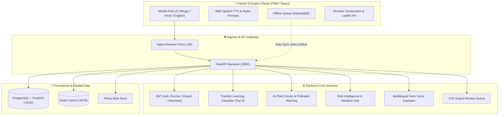

# 🌾 AgroSmart AI: Pollinator & Beneficial Insect Network

> **Empowering rural farmers with AI insect identification, mixed-bug co-detection, seasonal tracking, and community expert verification.**  
> Built for hackathons, designed for smallholders with low literacy and low-end smartphones.

---

## 🌟 Executive Summary

In Indian agriculture, over **70% of crop species** depend on insect pollination (increasing yields in cotton, pulses, and vegetables by 25–35%). Yet, over-spraying of broad-spectrum chemical pesticides wipes out honeybees and predator ladybirds, triggering pest resurgence.

**AgroSmart AI** is a farmer-first, mobile-optimized progressive web application that bridges smallholder farmers, local Krishi Vigyan Kendra (KVK) entomologists, and ecological data. Farmers photograph single or mixed insects, get instantaneous AI predictions with voice readouts in their native language (**Telugu, Hindi, English**), interact with a conversational **Voice AI Chatbot** upfront, view seasonal migration heatmaps, and send uncertain specimens to scientists for audit.

---

## 🚜 Farmer-First UX Rules

- **Zero Jargon**: Simple terminology replaces academic terms:
  - *"Helpful insect"* (మిత్ర పురుగు / मित्र कीट) instead of *predator/parasitoid*
  - *"Harmful insect"* (శత్రు పురుగు / शत्रु कीट) instead of *pest*
  - *"Bee"* (తేనెటీగ / मधुमक्खी) instead of *pollinator*
- **Mobile-First & Touch Accessible**: High-contrast green/earth theme with oversized tap targets (minimum **56px**).
- **Universal Voice (TTS & STT)**: Every screen and diagnosis has a prominent `🔊 Listen / వినండి / सुनिए` button powered by the Web Speech API (`SpeechSynthesis`), plus voice dictation for questions.
- **Max 3 Taps**: Core tasks (e.g. Photographing an insect, finding safe spraying hours, or asking a question) complete in 3 taps.
- **Color-Coded Feedback**:
  - 🟢 **Green**: Helpful insect (Protect & preserve)
  - 🔴 **Red**: Harmful insect (Organic bio-control steps)
  - 🟡 **Yellow**: Uncertain / Escalated to KVK scientist
- **Offline-First Resilience**: All sightings save locally to phone memory (`IndexedDB` / `localStorage`) and display a clear `Saved on phone (ఆఫ్‌లైన్)` badge, auto-syncing to the server once internet connectivity is restored.

---

## 🏗️ System Architecture



---

## 📂 Project Directory Structure

```text
agrosmart-ai/
├── backend/
│   ├── app/
│   │   ├── api/             # REST endpoints (auth, sightings, species, classify, doctor, risk, assistant, expert, export)
│   │   ├── core/            # Config, SQLAlchemy DB setup, JWT security & Haversine spatial math
│   │   ├── db/              # Seed script with 32 realistic sightings across farming belts
│   │   ├── models/          # SQLAlchemy models (User, Species, Sighting, ValidationLog, RiskAlert, AuditLog)
│   │   ├── schemas/         # Pydantic request/response schemas
│   │   └── services/        # ML classifier, Plant Doctor rule/LLM engine, Risk intelligence, Assistant
│   ├── main.py              # Application entry point with Lifespan database initialization
│   ├── requirements.txt     # Python dependencies
│   ├── schema.sql           # Production PostGIS DDL, spatial indexes, triggers & queries
│   ├── test_api.py          # End-to-end API test suite (11 test suites)
│   └── Dockerfile           # Backend container build
├── frontend/
│   ├── public/              # Icons, local vector SVGs (/insects/*.svg) & assets
│   ├── src/
│   │   ├── components/      # Farmer-first components (Header, HomeScreen, UploadScreen, ResultScreen, VoiceChatbotWidget, etc.)
│   │   ├── locales/         # i18n dictionaries (en.json, te.json, hi.json)
│   │   ├── services/        # API client, i18n & Web Speech API TTS helper, Offline sync engine
│   │   ├── App.jsx          # Main application router and state
│   │   └── index.css        # Tailwind CSS and high-contrast farmer styles
│   ├── nginx.conf           # Reverse proxy configuration
│   ├── package.json         # Node.js dependencies
│   ├── vite.config.js       # Vite configuration with Tailwind CSS plugin & backend proxy
│   └── Dockerfile           # Multi-stage frontend container build
├── ml_service/
│   ├── model_pipeline.py    # PyTorch / Transfer Learning classification wrapper (EfficientNet/MobileNet)
│   ├── requirements.txt     # Torch & CV dependencies
│   └── Dockerfile           # ML service container build
├── docker-compose.yml       # Production orchestrator (PostGIS, Redis, Backend, Frontend)
├── .github/workflows/ci.yml # GitHub Actions CI workflow
└── README.md                # Project documentation & demo script
```

---

## 🗄️ Database Schema (PostgreSQL + PostGIS)

The complete production DDL is located in [`backend/schema.sql`](file:///C:/Users/utthe/.gemini/antigravity/scratch/kisanmitra/backend/schema.sql).

### Key Tables & Spatial Indexes:
1. **`users`**: Phone number + OTP credentials, roles (`farmer`, `expert`, `volunteer`, `admin`), village, and language preference (`te`, `hi`, `en`).
2. **`species`**: Master catalog of 8+ agricultural species with vernacular names in Telugu & Hindi, ecological category (`helpful`, `harmful`, `uncertain`), role (`pollinator`, `predator`, `parasitoid`, `pest`), and farmer tips.
3. **`sightings`**: Insect observations with `latitude`, `longitude`, PostGIS `geom GEOMETRY(Point, 4326)` with spatial **GIST index**, crop name, photo URL, top AI prediction, confidence %, and verification status.
4. **`validations`**: Expert audit log recording confirms or reclassifications, expert notes, and `is_model_corrected` flag feeding model retraining pipelines.
5. **`risk_alerts`**: Spatial village alerts with radius, risk level (`LOW`, `MEDIUM`, `HIGH`), and recommended action.

### PostGIS Query Example (Find Bees within 5 km):
```sql
SELECT s.id, sp.common_name_en, s.crop_name, s.latitude, s.longitude,
       ST_Distance(s.geom::geography, ST_SetSRID(ST_MakePoint(79.5941, 17.9689), 4326)::geography) / 1000.0 AS distance_km
FROM sightings s
JOIN species sp ON s.species_id = sp.id
WHERE sp.role_type = 'pollinator'
  AND ST_DWithin(s.geom::geography, ST_SetSRID(ST_MakePoint(79.5941, 17.9689), 4326)::geography, 5000)
ORDER BY distance_km ASC;
```

---

## 🌐 REST API Endpoints & Example Requests

| Method | Endpoint | Description |
| :--- | :--- | :--- |
| `POST` | `/api/v1/auth/login` | Phone + OTP login (Quick personas: Farmer `9876543210`, Expert `9123456780`) |
| `GET` | `/api/v1/species` | Master catalog of helpful and harmful insects |
| `GET` | `/api/v1/sightings` | List sightings with filters for category, crop, village, month |
| `POST` | `/api/v1/sightings/upload` | Multipart photo upload + instant AI classification |
| `GET` | `/api/v1/sightings/stats/seasonal` | Month-by-month distribution for calendar charts |
| `POST` | `/api/v1/plant-doctor/diagnose` | Plant Doctor leaf diagnosis + low-cost remedies + pollinator warnings |
| `GET` | `/api/v1/risk/status` | Hyper-local field risk score (0-100) and safe spraying hours |
| `POST` | `/api/v1/risk/broadcast` | Simulate SMS / WhatsApp alert broadcast to village |
| `POST` | `/api/v1/assistant/chat` | Multilingual conversational voice assistant |
| `GET` | `/api/v1/expert/queue` | KVK Entomologist inspection queue (pending review items) |
| `POST` | `/api/v1/expert/verify/{id}` | Confirm or reclassify species + log model retraining feedback |
| `GET` | `/api/v1/export/geojson` | Export observations as standard GeoJSON FeatureCollection |
| `GET` | `/api/v1/export/csv` | Download CSV for agricultural research stations |

### Sample cURL: Plant Doctor Diagnosis
```bash
curl -X POST "http://localhost:8000/api/v1/plant-doctor/diagnose" \
  -F "crop_name=Paddy" \
  -F "symptoms=fungal spindle spots on leaf"
```

### Sample cURL: Multilingual Assistant (Telugu)
```bash
curl -X POST "http://localhost:8000/api/v1/assistant/chat" \
  -H "Content-Type: application/json" \
  -d '{"message": "ఈ రోజు మందు పిచికారీ చేయవచ్చా?", "language": "te"}'
```

---

## 🚀 Setup & Execution Guide

### Option A: Run with Docker Compose (Recommended)

To run the complete full-stack system (PostGIS, Redis, FastAPI Backend, and Nginx React Frontend):

```bash
docker-compose up --build
```

- Frontend App: **http://localhost:3000**
- Backend API Docs (Swagger): **http://localhost:8000/docs**
- PostGIS Database: **localhost:5432** (Database: `agrosmart`, User: `agrosmart`, Password: `agrosmartpassword123`)

---

### Option B: Local Development (Without Docker)

#### 1. Backend Setup:
```bash
cd backend
python -m pip install -r requirements.txt
python main.py
```
*Note: The backend defaults to a local SQLite database with built-in Haversine spatial math when `DATABASE_URL` is omitted, running instantly without external database dependencies.*

#### 2. Run API Test Suite:
```bash
cd backend
python test_api.py
```

#### 3. Frontend Setup:
```bash
cd frontend
npm install
npm run dev
```
Open **http://localhost:3000** in your browser.

---

## 🎬 3-Minute Hackathon Demo Script

Here is an effective script to present **AgroSmart AI** to hackathon judges in exactly 3 minutes:

### ⏱️ 0:00 – 0:45 | The Problem & Farmer-First UX
1. **Hook**: *"Judges, smallholder farmers lose up to 35% of their crop yields not because they don't spray pesticides, but because they spray at the wrong time and kill their greatest allies—bees and beneficial insects."*
2. **First Screen**: Open **http://localhost:3000**. Highlight the language selector modal: tap **"తెలుగు" (Telugu)** or **"हिन्दी" (Hindi)**. Show that the choice is remembered.
3. **Voice & Simplicity**: Tap the top `🔊 Listen` button. The app speaks clearly in Telugu/Hindi. Point out the oversized (56px+) buttons and zero jargon: *"Helpful insect"* vs *"Harmful insect"*.

### ⏱️ 0:45 – 1:30 | 1-Tap Photo Upload & Color-Coded AI
1. Tap the big green **"పురుగు ఫోటో తీయండి" (Photograph Insect)** tile.
2. Under "Demo Samples", tap **"🐝 Honeybee"**. Show the automatic GPS coordinate tag and the mini draggable map pin.
3. Tap **"Check Insect with AI"**.
4. Within 1 second, the **Result Screen** appears with a bold 🟢 **Green Card**:
   - Primary Guess: **Indian Honeybee (తేనెటీగ - మిత్ర పురుగు)** with **94% confidence**.
   - Action Tip: *"This bee pollinates your crop. Avoid spraying today!"*
   - Tap `🔊 వినండి` to let judges hear the spoken advice.

### ⏱️ 1:30 – 2:15 | AI Plant Doctor & Seasonal Patterns Map
1. From the bottom navigation bar, tap **"మొక్కల వైద్యుడు" (AI Plant Doctor)**.
2. Select **"🌾 Rice Blast"** sample leaf. Tap **"Diagnose Crop Problem"**.
3. **Highlight the Pollinator Safety Warning**: Show the prominent orange banner warning the farmer *never* to spray synthetic pesticides while pollinators forage, offering low-cost organic recipes (Jeevamrutha, fermented buttermilk) instead.
4. Tap **"రుతువుల మ్యాప్" (Seasonal Map)**. Show the 32 real pre-seeded sightings across Warangal and neighbouring districts with green pins for pollinators and red pins for pests.
5. Scroll down to show the **Month-by-Month activity chart (Recharts)** showing when bees peak (August–November).

### ⏱️ 2:15 – 3:00 | Risk Alerts, Voice Assistant & Expert Audit Loop
1. Tap **"హెచ్చరికలు" (Risk Alerts)**: Show the current field risk score (e.g. 45/100, Medium Risk), the safe spraying window (*"Spray only after 5:30 PM"*), and tap **"Send"** to simulate a WhatsApp broadcast to village farmers.
2. Tap **"ఏఐ సహాయకుడు" (Voice Farm Assistant)**: Tap the suggested question *"ఈ రోజు మందు చల్లవచ్చా? (Can I spray today?)"* or speak into the microphone. Show the instant localized response.
3. **Expert Verification**: Tap the top role switcher to toggle to **🔬 Expert (Dr. Sunita Kulkarni)**. Open the **Expert Review Dashboard**. Show the inspection specimen, adjust the classification dropdown to confirm, and tap **"Confirm Species"**. Explain to judges: *"This completes the community feedback loop—expert validations directly update the dataset to retrain future PyTorch models."*

---

## 🌾 Seed Dataset Overview

The application comes pre-populated with **32 realistic field observations** across Telangana, Andhra Pradesh, Maharashtra, and Haryana:
- **Villages**: Hasanparthy, Dharmasagar, Wardhannapet, Narsampet, Geesugonda, Guntur, Tenali, Nizamabad, Nashik.
- **Crops**: Cotton, Chilli, Paddy (Rice), Maize, Groundnut, Mustard, Tomato, Turmeric.
- **Species**: *Apis cerana indica* (Indian Honeybee), *Coccinella septempunctata* (Seven-Spot Ladybird), *Chrysoperla carnea* (Green Lacewing), *Spodoptera frugiperda* (Fall Armyworm), *Bemisia tabaci* (Cotton Whitefly), *Syrphidae spp.* (Hoverfly), *Helicoverpa armigera* (Pod Borer), *Trichogramma chilonis* (Micro-wasp).
- **Temporal spread**: Distributed across all 12 months to provide rich seasonal trends.

---

## 📜 License

Created for demonstration and agricultural development hackathons. Built with ❤️ for the farming community.
